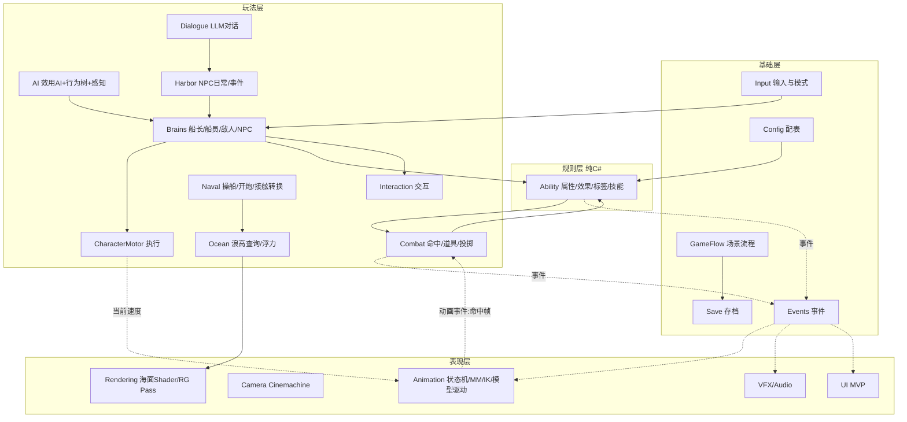

# WaveWarlord 系统总图

版本：草案0.1（2026-10-18）。**由助手按计划V3.1整理，属于架构草案，待用户审定**；各系统做到时，按“模块六步”由用户再做方案比较并修订本图。3C部分以用户已决定的三层移动架构（`R1-W1_基础移动.md`）为起点。

## 1. 分层与依赖规则

```text
表现层      Camera · Animation表现 · VFX · Audio · UI · Rendering
              ▲ 订阅事件 / 读取状态
玩法层      Character（Brain→Motor）· Combat · AI · Interaction · Naval · Harbor/NPC · Dialogue
              ▲ 调用接口
规则层      Ability（属性/效果/标签/技能，纯C#）· 战斗计算
              ▲
基础层      GameFlow/场景 · Save · Config(Luban) · Assets(YooAsset) · Input · Events · Time
```

1. **只允许上层依赖下层**；下层通过事件通知上层，不直接引用上层。
2. **执行与决策分离**：执行层（Motor、能力执行）不知道指令来自玩家、AI船员还是敌人。
3. **规则层是纯C#**（不继承MonoBehaviour），只对这一层写EditMode测试。
4. **通信方式**：每帧连续数据（速度、朝向）走直接调用；离散事件（命中、死亡、拾取、对话开始）走事件。
5. **系统间引用方式待定**（序列化引用、GetComponent、服务定位或依赖注入），学完模式卡06后由用户决定；**默认不用单例**。

## 2. 依赖关系图



## 3. 系统清单

| 系统 | 负责 | 不负责 | 对外接口（草案） | 落地时间 | 模式卡 |
|---|---|---|---|---|---|
| **Input** | 持有GameInput；按场景切换动作表（港口／战斗／UI／对话） | 不知道角色与世界坐标 | `Move`、`Sprint`；离散动作用事件 | 2026-10～11（W1已有Reader） | 05状态机 |
| **CharacterMotor** | 合并本帧位移（移动＋重力＋击退），每帧调用一次`Move`；对外暴露当前速度 | 不知道指令来源 | `SetMoveVelocity(Vector3)`；`Velocity`；`IsGrounded` | W1建立，第2周加重力 | 02更新方法、03组件 |
| **Brains** | 把“意图”变成对Motor和能力系统的调用：CaptainController（玩家）、CrewBrain、EnemyBrain、NpcBrain | 不直接操作CharacterController | 统一的“角色控制接口”（AI也是按按键的玩家） | 船长W1；AI 2027-03～05；NPC 2027秋 | 03组件 |
| **Interaction** | 检测可交互物，显示提示，触发交互 | 不处理交互的具体业务 | `IInteractable.Interact(actor)`；进入／离开范围事件 | 2026-11 | 04观察者 |
| **Camera** | 港口跟随、战斗镜头、演出镜头切换 | 不决定移动方向（相机相对移动只提供朝向） | 提供相机朝向；按状态切换虚拟相机 | 2026-11（跟随）；战斗镜头2027-01 | 06服务定位 |
| **Ability（规则层）** | 属性（基础值／运行时值）、效果（伤害、燃烧、眩晕）、标签、技能的激活／消耗／冷却 | 不播放动画和特效 | `TryActivate(abilityId, target)`；`ApplyEffect`；属性变化与效果事件 | 2027-01～02 | 10数据驱动、11 GAS、12脏标记 |
| **Combat** | 命中判定（动画事件指定帧＋检测形状）、受击与倒地、道具拾取／投掷／破坏 | 不计算伤害数值（交给Ability） | `OnHit`、`OnPickup`、`OnThrow`事件；可拾取物接口 | 2027-01～05 | 07命令、13对象池 |
| **AI** | 感知（附近敌人、道具、掩体）；效用打分选目标与行动；行为树执行 | 不绕过能力系统直接改数值 | 输出给Brain的意图；可调试的打分面板 | 2027-03～05 | 14效用AI、15行为树、16空间划分 |
| **Animation** | 动画状态机 → IK（拾取、脚部贴地）→ Motion Matching → 研究模型驱动的重点片段 | 不决定逻辑结果（只通过动画事件报告“命中帧”） | 读取Motor速度与能力状态；发出动画事件 | 2026-12基础；IK 2027春；MM 2027暑假；模型2027秋 | 05状态机、19 ECS与数据局部性、20双缓冲 |
| **Naval** | 开炮阶段操船、侧舷开火、敌船生命、转入接舷 | 接舷后的人物战斗 | 船只控制接口；“可接舷”事件 | 2027暑假 | — |
| **Ocean** | Gerstner波；按位置查询浪高与法线；船只浮力 | 不负责视觉以外的玩法规则 | `GetHeight(x, z)`；浮力组件 | 2027暑假基础版；2027秋视觉增强 | 20双缓冲（回读） |
| **Harbor / NPC** | NPC日常行为与时间安排；多角色交互事件 | 不生成对话内容 | NPC状态；事件触发点 | 2027-09～11 | 05状态机 |
| **Dialogue** | 对话界面与流程；LLM接口（DeepSeek，可替换）；超时退回预设台词；结构化输出（台词／情绪／意图）驱动动作选择 | 不在仓库中保存密钥 | `IDialogueProvider.RequestAsync(context)` | 2027-09～11 | 18 MVC/MVP |
| **GameFlow / Save** | 场景流程：港口→出航→开炮→接舷→结算→回港；存档 | 不处理具体玩法 | 流程状态机；`Save/Load` | 2027-05骨架流程；暑假接YooAsset | 05状态机 |
| **Config / Assets** | Luban配表（技能、道具、NPC）；YooAsset资源与场景加载 | — | 只读配置对象；异步加载 | Luban 2027-01；YooAsset 2027暑假 | 10数据驱动 |
| **VFX / Audio / UI** | 订阅事件播放表现；UI采用MVP | 不改变游戏状态 | 订阅Events | 随各模块；2027秋集中打磨 | 18 MVC/MVP、13对象池 |
| **Rendering** | 海面Shader、战斗特效Shader、一个Render Graph自定义Pass | — | 材质参数、Renderer Feature | 2027暑假／秋 | — |

## 4. 关键数据流（示例）

1. **玩家移动（W1）**：GameInput → PlayerInputReader.Move → CaptainController（映射到世界方向×moveSpeed）→ CharacterMotor.SetMoveVelocity → Update中×deltaTime → CharacterController.Move（碰撞与沿墙滑动）→ Animation读取`Velocity`（12月起）。
2. **一次轻击（2027-01）**：输入“攻击” → Brain → Ability.TryActivate（检查消耗与冷却）→ 播放攻击动画 → 动画事件“命中帧” → Combat命中检测 → Ability.ApplyEffect（伤害计算）→ 事件“受击” → 受击动画、特效、UI、音效。
3. **AI船员捡炸弹并投掷（2027-03～05）**：AI感知附近炸弹 → 效用打分选择“拾取并投掷” → CrewBrain移动到目标（Motor）→ IK抓取 → Combat.Pickup → Ability.TryActivate(投掷) → 抛物线投掷物 → 爆炸 → 范围效果 → 事件。
4. **NPC对话（2027秋）**：Interaction触发 → Dialogue.RequestAsync（附带NPC人设与上下文）→ LLM返回台词、情绪、意图 → UI显示台词 → 根据情绪／意图选择动作（Motion Matching片段或研究模型生成）→ 超时则使用预设台词。

## 5. 待用户审定的设计问题

| 问题 | 何时决定 | 参考 |
|---|---|---|
| 系统间怎样拿到彼此的引用（序列化、GetComponent、服务定位、依赖注入） | 学完模式卡06后（2026-11） | Zodiac的Hub与MonoSingleton可作为反例对照 |
| 离散事件用C# event／接口回调，还是全局事件总线 | 模式卡04（2026-11，交互模块） | 全局总线易用，但不易追踪调用关系 |
| 战斗由动画驱动（根运动、命中帧来自动画），还是由逻辑驱动（逻辑定时、动画只跟随） | 2026-12动画基础 | 影响手感与AI复用 |
| 开炮阶段和接舷战在同一场景，还是切换场景 | 2027-05骨架流程前 | 同场景过渡更自然，切换场景更简单 |
| 规则层是否允许引用`UnityEngine`的数学类型（如Vector3） | 2027-01战斗核心 | 影响测试和移植性 |

## 6. 修订记录

| 日期 | 变化 |
|---|---|
| 2026-10-18 | 草案0.1：助手按计划V3.1与W1三层移动架构整理，待用户审定 |
